# Instalación de MariaDB, PHP y WordPress

Alumno: Pau Zurriaga Zapata

Ciclo: SMX

Módulo: Aplicaciones Web

Fecha: 28/10/2026

---------

## Apartado 1

Lo primero que haremos será conectarnos al servidor por SSH y comprobar su IP. Después revisaremos que Apache y MariaDB estén activos y que PHP esté instalado.

**Salidas**

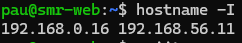

En esta salida vemos la IP del servidor obtenida con el comando .

```
hostname -I
```
**Capturas**

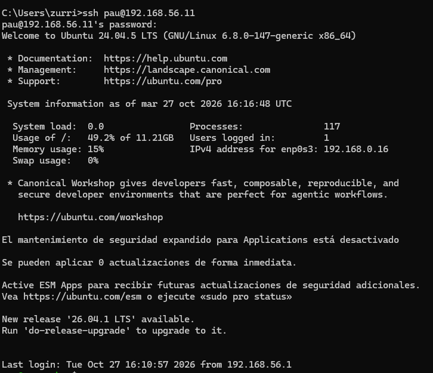

Aquí se ve la conexión por SSH al servidor.

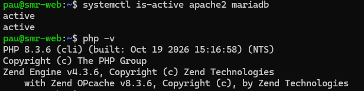

En esta captura comprobamos el estado de Apache y MariaDB y la versión de PHP.

**Pregunta**

¿Qué puertos utilizan normalmente SSH y HTTP?

SSH utiliza normalmente el puerto 22 y HTTP utiliza el puerto 80.

## Apartado 2

En este apartado deshabilitaremos los sitios de la práctica anterior y dejaremos activado el sitio predeterminado de Apache. Después comprobaremos la configuración y accederemos a la página desde el navegador.

**Salidas**

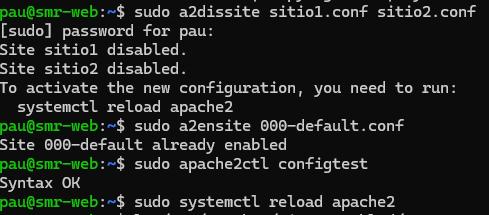

En esta salida se ve cómo deshabilitamos los sitios anteriores y activamos el sitio predeterminado.

**Capturas**

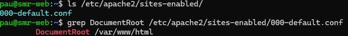


En esta captura se ve la página predeterminada de Apache desde el navegador.

**Preguntas**

¿Cuál es la diferencia entre `a2dissite` y borrar directamente un archivo de configuración?

El comando `a2dissite` deshabilita el sitio quitando el enlace de la carpeta de sitios habilitados. El archivo de configuración original se mantiene en la carpeta de sitios disponibles.

¿Por qué aparece la página predeterminada de Apache?

Porque Apache está usando la configuración del sitio predeterminado, cuyo directorio web es `/var/www/html`.

## Apartado 3

En este paso crearemos la base de datos de WordPress y un usuario específico para acceder a ella. De esta forma, WordPress no tendrá que utilizar el usuario administrador de MariaDB.

**Capturas**

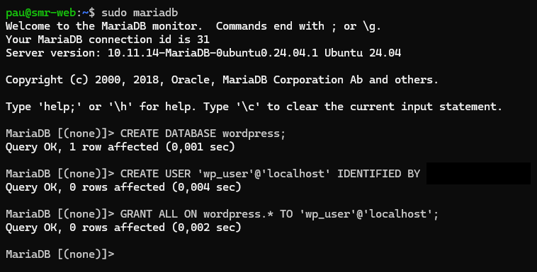

En esta Captura se ve la creación de la base de datos `wordpress` y del usuario `wp_user`, junto con los permisos asignados.

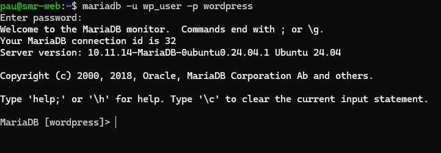

Aquí comprobamos que podemos acceder a MariaDB con el usuario de WordPress.

**Pregunta**

¿Por qué es mejor que WordPress utilice un usuario propio en lugar de `root`?

Porque el usuario propio solo necesita permisos sobre la base de datos de WordPress. Si hubiera un problema de seguridad, tendría menos privilegios que el usuario `root`.

## Apartado 4

En este apartado descargaremos WordPress, lo descomprimiremos y copiaremos sus archivos al directorio web de Apache. Después eliminaremos los archivos que ya no hacen falta y configuraremos los permisos.

**Capturas**

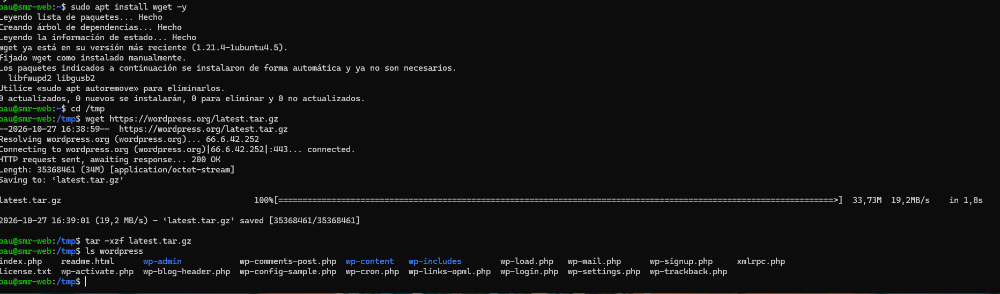

En esta captura se ve la descarga y descompresión de WordPress.

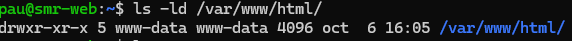

En esta Captura se comprueba el propietario y los permisos de los archivos de WordPress.

**Preguntas**

¿Para qué sirven los comandos `cp`, `rm` y `chown`?

`cp` copia archivos, `rm` elimina archivos y `chown` cambia el propietario y el grupo de los archivos.

¿Por qué asignamos los archivos a `www-data`?

Porque es el usuario que utiliza normalmente Apache en Ubuntu. Así el servidor web puede acceder a los archivos y gestionarlos según los permisos configurados.

## Apartado 5

En este apartado terminaremos la instalación de WordPress desde el navegador. Primero accederemos a la dirección IP del servidor y aparecerá el asistente de instalación de WordPress.

A continuación, introduciremos los datos de conexión con la base de datos que hemos creado anteriormente. Indicaremos el nombre de la base de datos `wordpress`, el usuario `wp_user`, la contraseña que hayamos configurado y el servidor de la base de datos, que normalmente será `localhost`.

Después de comprobar la conexión, configuraremos el título del sitio web y crearemos la cuenta administradora, indicando un nombre de usuario, una contraseña y un correo electrónico. Finalmente, completaremos la instalación y accederemos al panel de administración para comprobar que WordPress se ha instalado correctamente.

**Pregunta**

¿Por qué completamos la instalación desde el navegador en vez de hacerlo todo desde la terminal?

Porque WordPress dispone de un asistente web que permite configurar el sitio y crear la cuenta administradora de forma sencilla. No es necesario instalar un entorno gráfico en el servidor, ya que podemos realizar la configuración desde el navegador de otro equipo.

## Apartado 6

En este apartado comprobaremos que WordPress funciona, entraremos al panel de administración y publicaremos una entrada de prueba. Después revisaremos las tablas de la base de datos.

**Capturas**

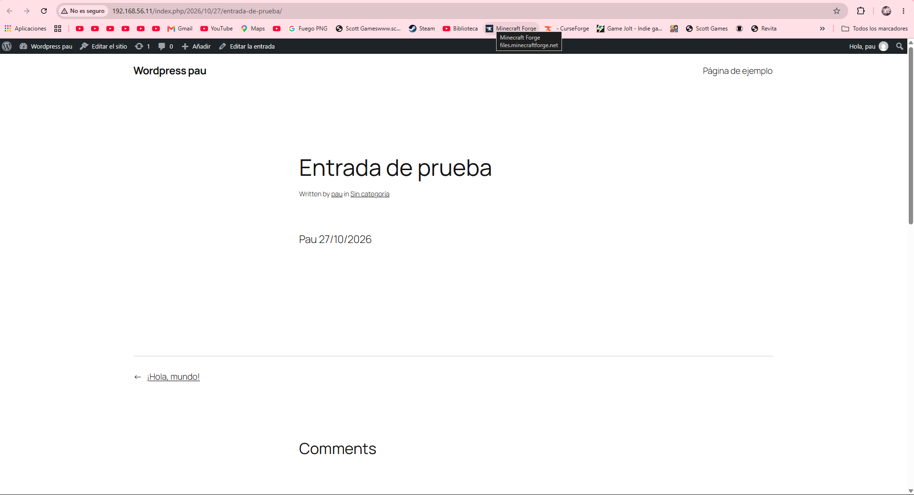

En esta captura se ve la página principal del sitio WordPress.

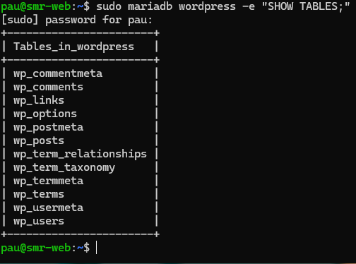

En esta captura se ve el resultado de SHOW TABLES.

**Pregunta**

¿Dónde se guardan las entradas que publicamos en WordPress?

Las entradas se guardan en la tabla `wp_posts` de la base de datos. En esa tabla también se almacena información de otros tipos de contenido.

## Apartado 7

En este apartado editaremos el archivo `wp-config.php` para configurar las direcciones del sitio y comprobaremos que el archivo PHP no tiene errores de sintaxis.

**Capturas**

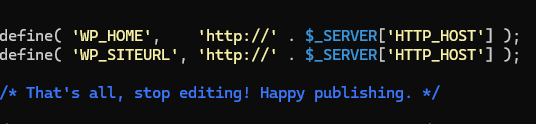

En esta captura se ve como he puesto las dos lineas en wp-congig.php.

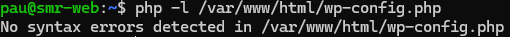

En esta salida se ve la comprobación de sintaxis realizada con `php -l`.

**Pregunta**

¿Para qué sirven `WP_HOME` y `WP_SITEURL`?

Sirven para indicar la dirección principal del sitio y la dirección donde se encuentran los archivos de WordPress. En una instalación real conviene configurar una dirección fija y usar HTTPS cuando esté disponible.

## Apartado 8

En este paso configuraremos Apache para permitir las reglas de WordPress y activaremos el módulo `rewrite`. También aumentaremos el tamaño máximo permitido para las subidas de archivos de PHP a 64 MB.

**Salidas**


En esta salida se ve la configuración de Apache para el directorio de WordPress.


Aquí comprobamos que la configuración de Apache es correcta y que el módulo `rewrite` está activado.


En esta salida comprobamos la configuración del tamaño máximo de subida de PHP.

**Capturas**

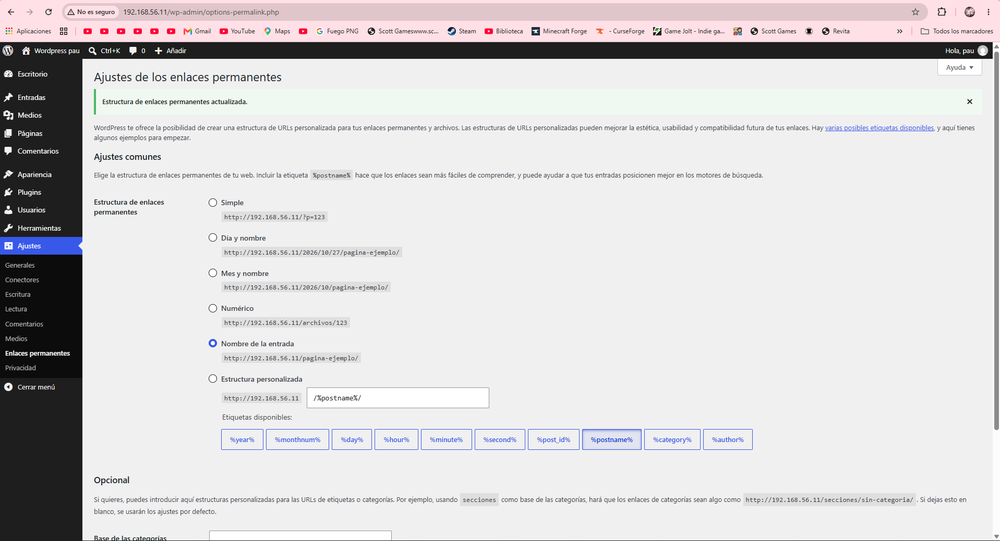

En esta captura se ve la configuración de los enlaces permanentes de WordPress.

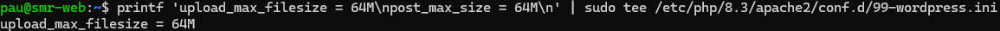

En esta captura comprobamos que una página con un enlace permanente se abre correctamente.

**Pregunta**

¿Por qué pueden dar error 404 los enlaces permanentes si Apache ignora el archivo `.htaccess`?

Porque WordPress utiliza las reglas de ese archivo para dirigir las peticiones a la página correcta. Si Apache no permite esas reglas o el módulo `rewrite` está desactivado, algunas direcciones pueden devolver un error 404.

## Apartado 9

En este apartado pararemos MariaDB para comprobar qué ocurre cuando WordPress no puede conectarse a la base de datos. Después volveremos a iniciar el servicio y comprobaremos que el sitio funciona otra vez.

**Capturas**

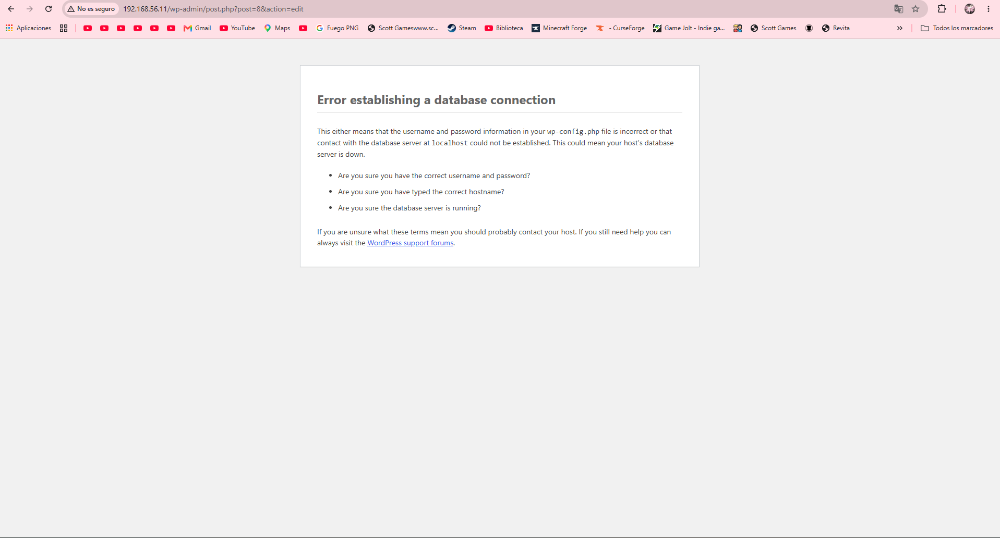

En esta captura se ve el error que aparece al intentar acceder a WordPress con MariaDB detenido.

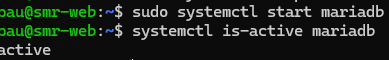

En esta captura comprobamos que WordPress vuelve a funcionar después de recuperar el servicio.

**Pregunta**

Si WordPress no pudiera conectar con la base de datos, ¿qué comprobarías y en qué orden?

Primero comprobaría el estado de MariaDB con `systemctl status mariadb` o `systemctl is-active mariadb`. Después revisaría que los datos de conexión de `wp-config.php` sean correctos y, por último, consultaría los registros de error si el problema continúa.

## Apartado 10

En este último apartado haremos las comprobaciones finales de Apache, MariaDB, PHP y WordPress. También guardaremos una instantánea de la máquina virtual si lo pide la práctica.

**Salidas**

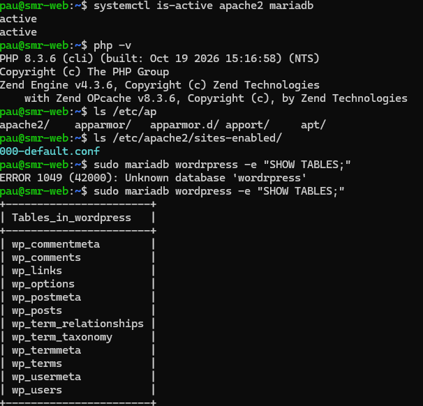

En esta salida se ven las comprobaciones finales de los servicios y de PHP.

**Comprobaciones finales**

| Elemento | Resultado |
|---|---|
| Apache | [Activo / pendiente de comprobar] |
| MariaDB | [Activo / pendiente de comprobar] |
| PHP | [Versión instalada] |
| WordPress | [Funciona / pendiente de comprobar] |
| Base de datos | [Conexión correcta / pendiente de comprobar] |
| Enlaces permanentes | [Funcionan / pendiente de comprobar] |
| Instantánea de la máquina virtual | [Guardada / no solicitada] |

## Conclusiones

En esta práctica he aprendido a instalar y configurar WordPress en un servidor Ubuntu, utilizando Apache, MariaDB y PHP. También he creado una base de datos y un usuario específico para WordPress, y he configurado los permisos de sus archivos.

Además, he comprobado el funcionamiento del sitio desde el navegador, he publicado una entrada de prueba y he revisado las tablas de la base de datos. Por último, he configurado los enlaces permanentes y he comprobado qué ocurre cuando MariaDB está detenido.


