# Instalacion, Configuracion y securizacion de apache en Ubuntu

Alumno: Pau Zurriaga Zapata

Ciclo: SMX

Modulo: Aplicaciones Web

Fecha: 15/10/2026

---------

### Apartado 1

**Salida de comandos**

```sudo apt update | sudo apt upgrade -y```
Con este comando descargas e instalas la ultima versión de el servidor además tiene la opción -y que hace que automáticamente responda a todo que si.

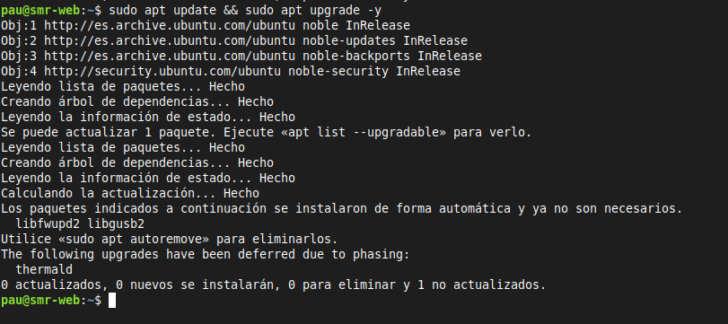

**captura**

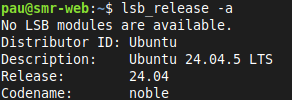

En esta captura se muestra la version actual de ubuntu despues de actualizarlo.

### Apartado 2

**Salida de comandos**

```sudo apt install apache```
Con este comando instalas apache en tu servidor.

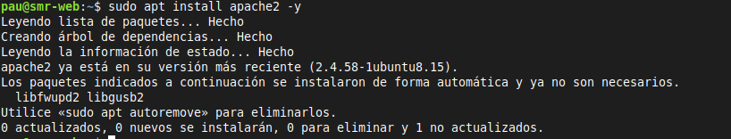

```apache2 -v```
Con este comando se ve la version de apache que tiene instalado.

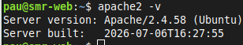

**Pregunta**

¿Qué paquetes adicionales se han instalado como dependencias? 

Los paquetes adicionales que se instalan como dependencias son libfwupd2 y libgusb2.

### Apartado 3

**Salida de comandos**

```sudo ss -tulpn | grep apache2```
El primer comando es ss que sirve para mostrar las conexiones de red y comprobar que puertos están en escucha con opciones y luego con la tubería se filtra para que muestre las líneas en las que ponga apache2.
Las opciones significan:

+ t: muestra conexiones TCP.
+ u: muestra conexiones UDP.
+ l: muestra los puertos en escucha.
+ p: muestra el proceso que usa el puerto.
+ n: muestra los puertos y direcciones numéricamente.

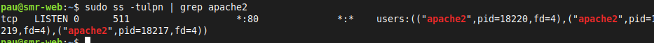

```curl -I http://localhost```
En la imagen se realiza una peticion a localhost.

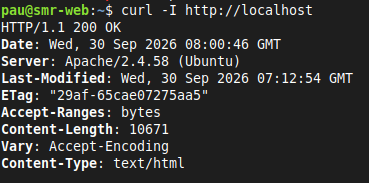

```sudo ufw status```
```sudo ufw allow 'Apache```
En esta imagen se configura el cortafuegos.

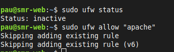

**captura**

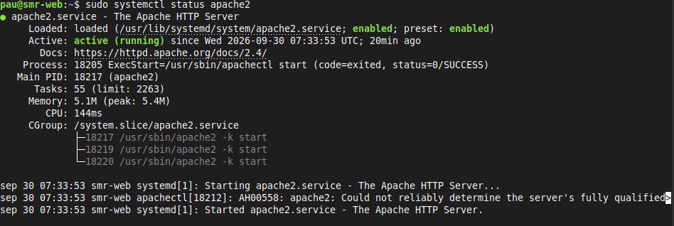

En la captura se ve el estado de el servicio apache.

**Pregunta**

¿Qué diferencia hay entre los perfiles Apache, Apache Full y Apache Secure?

La diferencia entre estos perfiles son los puertos por los que permiten conexion.
+ Apache: puerto 80
+ Apache full: puerto 80 y puerto 443
+ Apache sequre: puerto 443

### Apartado 4

| Comando | Funcion |
|---|---|
|sudo systemctl start apache2 |Este comando inicia el servicio |
|sudo systemctl stop apache2 |Este comando para el servicio |
|sudo systemctl restart apache2 |Para e inicia el servicio cortando todas las conexiones |
|sudo systemctl reload apache2 |Recarga el servicio sin pararlo completamente |
|sudo systemctl enable apache2 |Hace que el servicio arranque automáticamente al iniciar el sistema |
|sudo systemctl disable apache2 |Desactiva el arranque automático del servicio |
|apache2ctl configtest |Comprueba que la sintaxis de la configuración este correcta |
|apache2ctl -S |Muestra los sitios cargados |
|apache2ctl -M |Lista los modulos cargados |
|a2enmod / a2dismod |Activa / desactiva módulos |
|a2ensite / a2dissite |Activa / desactiva sitios |
|a2enconf / a2disconf  |Activa / desactiva fragmentos de configuración |

**Pregunta**

¿Cuándo conviene usar reload en lugar de restart?

Conviene usar reload si quieres modificar la configuración de apache pero no quieres parar completamente el servicio.

### Apartado 5

| Ruta | Descripción |
|---|---|
|/etc/apache2/apache2.conf |Este es el archivo de configuracion principal de apache2 |
|/etc/apache2/ports.conf|En este archivo están los puertos en los que apache escucha |
|/etc/apache2/sites-available/ |Aquí se guardan los sitios disponibles em el servidor que no están necesariamente activos |
|/etc/apache2/sites-enabled/ |En este archivo se estan los enlaces a los sitios activos |
|/etc/apache2/mods-available/ y mods-enabled/ |En esta carpeta se guardan los módulos activos  y disponibles|
|/etc/apache2/conf-available/ y conf-enabled/ |Donde se guardan fragmentos de configuración tanto disponible como activos |
|/etc/apache2/envvars |Es el archivo que guarda las variables de del entorno de el servidor |
|/var/www/html/ |Es el directorio raiz por defecto |
|/var/log/apache2/access.log|Archivo donde se almacenan los registros de el servidor |
|/var/log/apache2/error.log |Archivo donde se almacenan los Errores de el servidor |

**Salida de comandos**

```ls -l /etc/apache2/sites-enabled/```
Se lista la carpeta sites-enabled

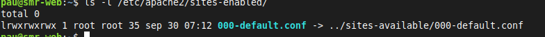

**captura**

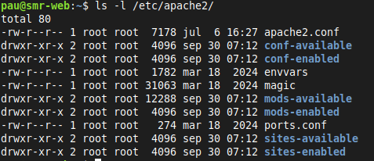

Se lista la carpeta apache2 en la ruta /etc/apache2.

**Pregunta**

¿Por qué Apache usa enlaces simbólicos entre los directorios *-available y *-enabled?

Porque permite tener las configuraciones disponibles por separado para poder desactivar sitos, módulos y configuraciones sin tener que mover ni duplicar sus archivos orgiginales.

### Apartado 6

**captura**

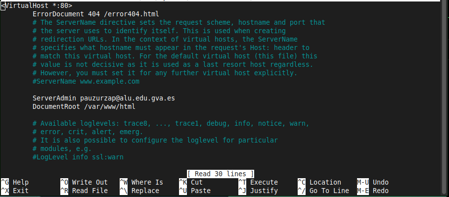

En la captura se muestran cambios que he hecho en la configuración de apache.

### Apartado 7

| Modulo | Función |
|---|---|
|mod_rewrite |Reescritura de URL |
|mod_headers |Manipulación de cabeceras HTTP |
|mod_ssl |Soporte HTTPS |
|mod_dir |Gestión de ficheros índice (index.html) |
|mod_alias |Redirecciones y alias de rutas |
|mod_auth_basic |Autenticación básica |
|mod_status  |Página de estado del servidor |
|mod_php / PHP-FPM |Ejecución de PHP (opcional) |

**Salida de comandos**

```apache2ctl -M```
En la salida de este comando se listan los módulos activos.

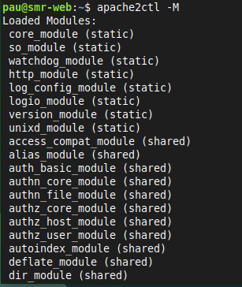

```ls /etc/apache2/mods-available/```
Con este comando se listan los modulos en la carpeta mods avaliable.

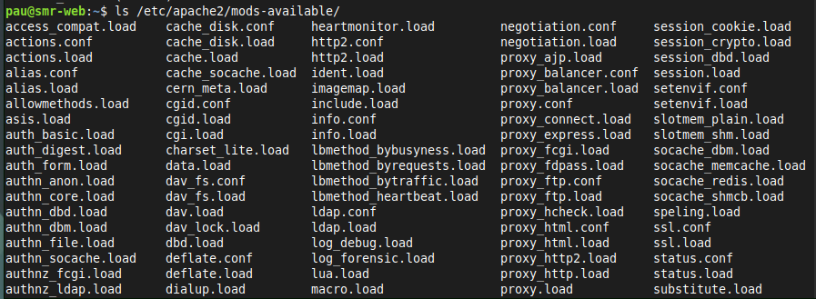

```sudo a2enmod rewrite```
```sudo a2enmod headers```
```sudo a2enmod ssl```
```sudo systemctl restart apache2```
```apache2ctl -M | grep -E "rewrite|headers|ssl"```
Con estos comandos compruebo algunos módulos habituales.

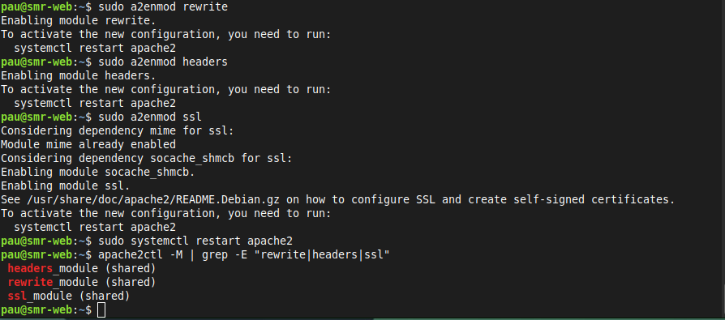

```sudo a2dismod status```
```sudo systemctl restart apache2```
Aquí estoy deshabilitando un modulo.

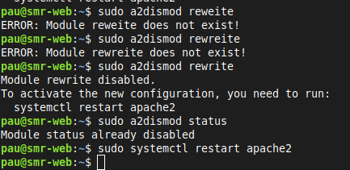

**Pregunta**

¿Qué ocurre si desactivas un módulo del que depende otro?

Puede que el mmodulo que genera la dependendia deje de funcionar bien o que apache no te deje eliminarlo.

### Apartado 8

**captura**

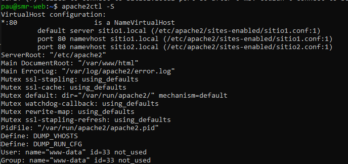

Se muestran los hosts cargados.

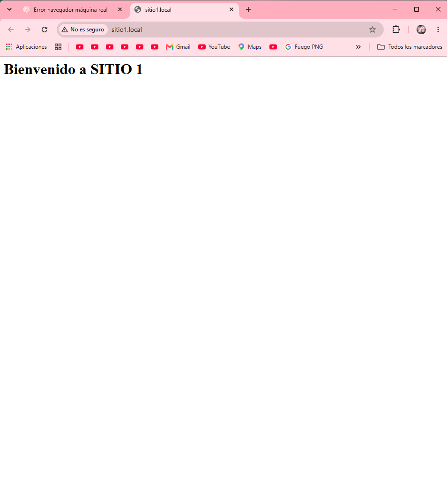

Se muestra en el navegador de la maquina real la pagina 1 cargada.


Se muestra en el navegador de la maquina real la pagina 2 cargada.

**Pregunta**

¿Qué diferencia hay entre virtual hosts basados en nombre y basados en IP? ¿Cuál has usado?

Los virtual host basados en nombre te permiten alojar varias webs en una misma dirección IP y distinguirlas por el nombre que se solicita, mientras que los basados en IP usan direcciones IP distintas para diferenciar los sitios.

En esta practica se ha usado virtual host basados en nombre ya que sitio1.local y sitio2.local estan alojados en la misma IP.

### Apartado 9

**captura**


Se ve un error provocado porque le he quitado todos los permisos a la pagina por lo cual salta el error 403.

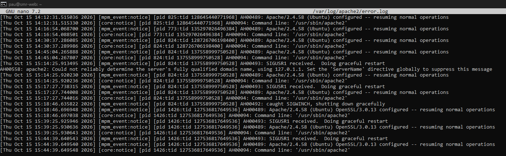

Este es el log de los errores.

**Permisos**

los permisos 755 y 644 son:
+ 755: el propietario puede leer, escribir y ejecutar; el grupo y los demás pueden leer y ejecutar.
+ 644: el propietario puede leer y escribir; el grupo y los demás solo pueden leer.

Nunca se deben usar los permisos 777 en un servidor porque les estas otorgando permisos totales a todos los usuarios.

El contenido root no debe pertenecer a todos ni ser editable porque dificultaria la gestion segura del contenido y puede aumentar los riesgos de seguridad.

### Conclusiones y problemas

**Conclusion**

En esta practica he aprendido a instalar y configurar el servidor web apache en ubuntu, también he aprendido a comprobar el estado del servicio, usar sus principales comandos de administración y conocer los archivo y directorios mas importantes de su configuracion.

También he aprendido a modificar la pagina web predeterminada, a activar y desactivar módulos y configurar varios sitios web mediante virtual host.

Por ultimo también he trabajado la gestión de permisos y propietarios de los archivos, comprendiendo la importancia de aplicar bien los permisos para mantener la seguridad del servidor.

**Problemas**

Durante la práctica he tenido algunas dificultades para comprender la configuración de los sitios virtuales y acceder a ellos desde el ordenador real. Para solucionarlo, he revisado la configuración de Apache y la resolución de nombres mediante el archivo hosts.

Otro aspecto que me ha resultado confuso ha sido distinguir entre los archivos de configuración y los archivos de registro. He aprendido que envvars contiene variables de entorno de Apache, mientras que access.log registra las peticiones recibidas y error.log almacena información sobre los errores del servidor.

También he aprendido a interpretar los permisos de Linux, como 644 y 755, y a consultar los registros de Apache para identificar posibles problemas.


