# Instalacion de MariaDB, PHP y Wordpress


Alumno: Pau Zurriaga Zapata

Ciclo: SMX

Modulo: Aplicaciones Web

Fecha: 15/10/2026

---------

## Apartado 1

Lo primero que hay que hacer es preparar el servidor deshabilitando los dos sitios que creamos en la practica anterior y dejaremos solo uno además luego actualizaremos el servidor.

**Capturas**

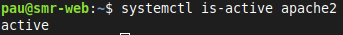

En la captura comprobamos la versión de apache.

## Apartado 2

 En este paso instalaremos mariaDB en el servidor y comprobaremos la version.

 **Capturas**

 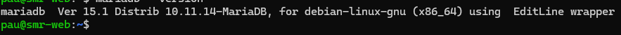

 En esta imagen vemos la version de MariaDB que hemos instalado.

 **Salidas**

  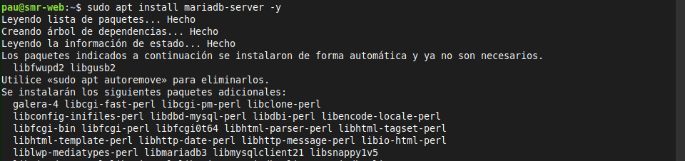

En esta imagen se ve la salida de la instalacion de MariaDB.
 
 ## Apartado 3

 En este paso comprobaremos el funcionamiento de MariaDB en el servidor

  **Capturas**

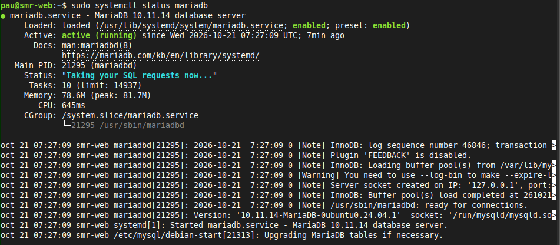

En esta captura vemos el estado de el servicio MariaDB.

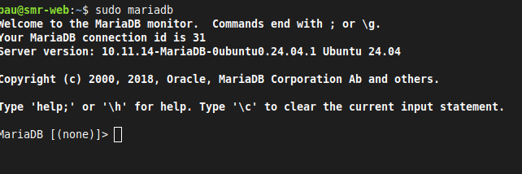

En esta captura se ve que funciona el comando de mariadb.

  **Salidas**

  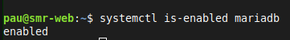

 En esta imagen se ve como MariaDB esta activado.

 ## Apartado 4

| Comando | Función |
|---|---|
|```sudo systemctl start mariadb``` |Este comando arranca el servicio MariaDB |
|```sudo systemctl stop mariadb``` |Este comando Detine el servicio MariaDB  |
|```sudo systemctl restart mariadb``` |Este comando reinicia el servicio MariaDB  |
|```sudo systemctl status mariadb```  |Este comando muestra el estado del servicio MariaDB  |
|```sudo systemctl enable mariadb```  |Este comando activa el arranque automatico de MariaDB |

 **Salidas**

 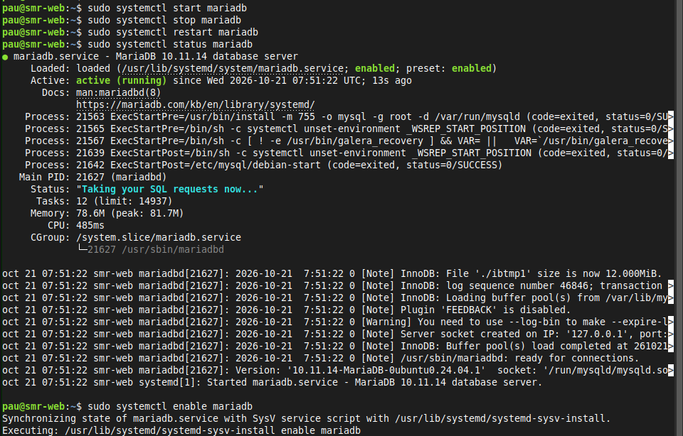

 ## Apartado 5

En este apartado comprobaremos que pasa si MariaDB esta parado.

**Capturas**

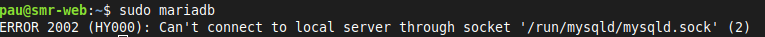

En esta captura se ve el error que ocurre cuando desactivamos MariaDB y ejecutamos el comando ```mariadb```.

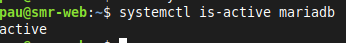

En esta captura vemos como hemos reactivado el servicio MariaDB con el comando ```sudo systemctl start mariadb```.

**Pregunta**

Si WordPress no pudiera conectar con la base de datos, ¿qué dos comandos de este apartado usarías
para saber si el problema es que MariaDB está parado? 

Usaria el comando  ```systemctl status mariadb``` o systemctl ```is-active mariadb```.

## Apartado 6

En este apartado instalaremos PHP y las piezas que Wordpress necesita.

**Capturas**

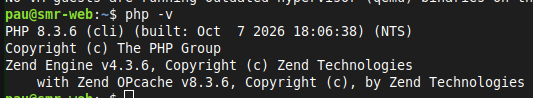

En esta capruta vemos la version de PHP.

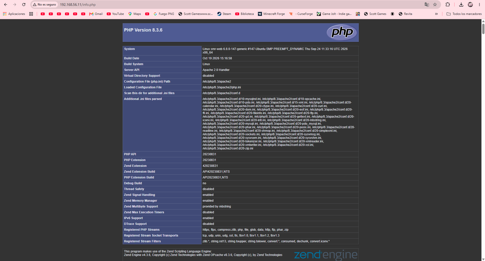

En esta captura se ve la pagina info.php.

 **Salidas**

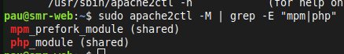

Aquí vemos los módulos descargados con PHP.

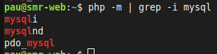
 


